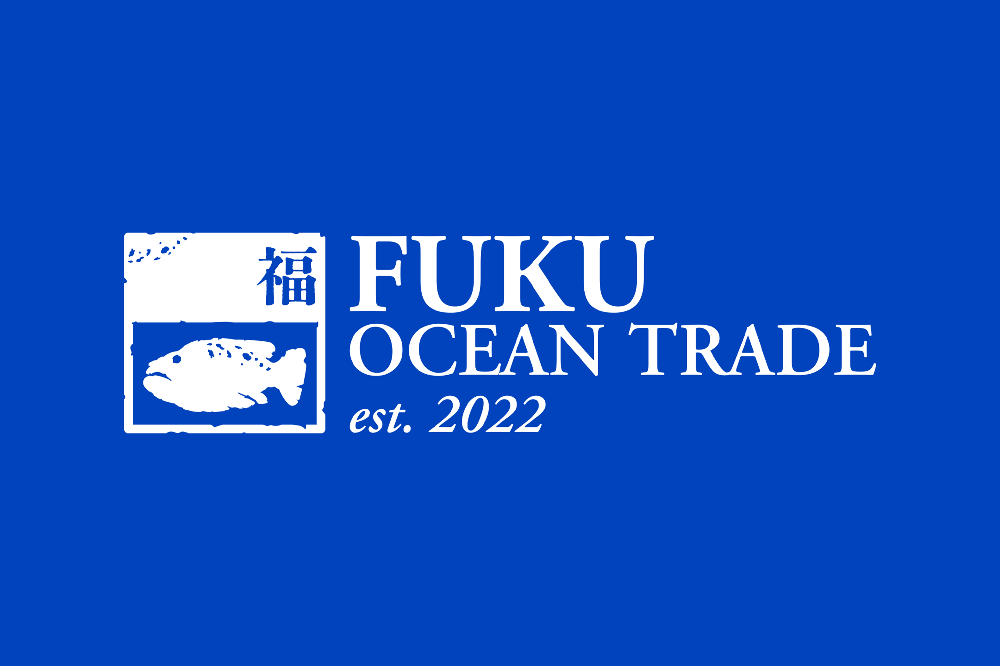
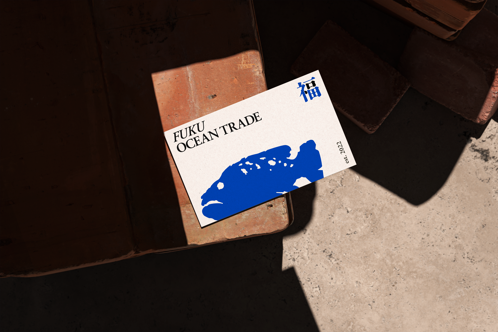
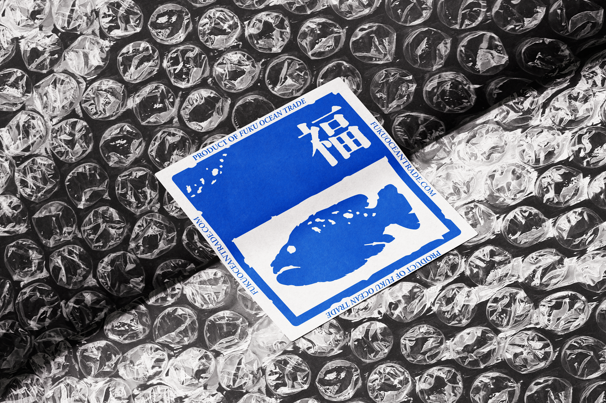
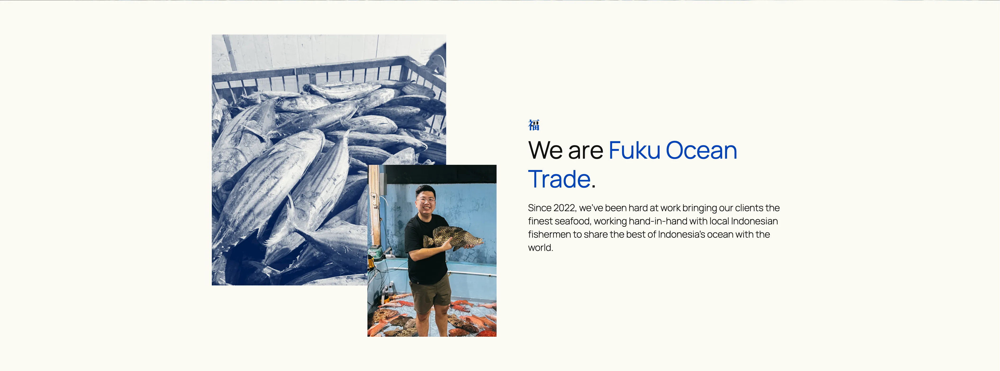
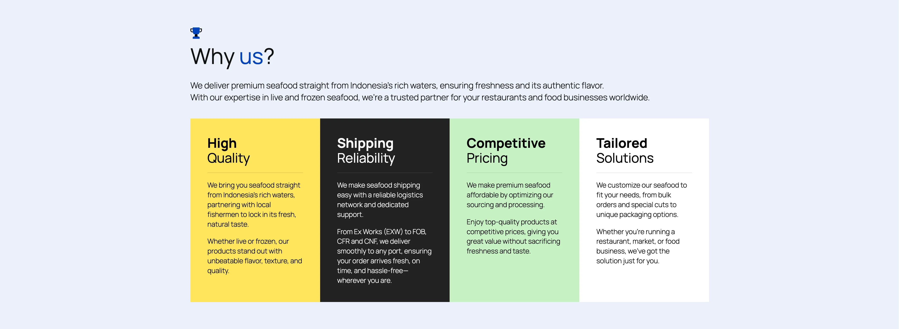
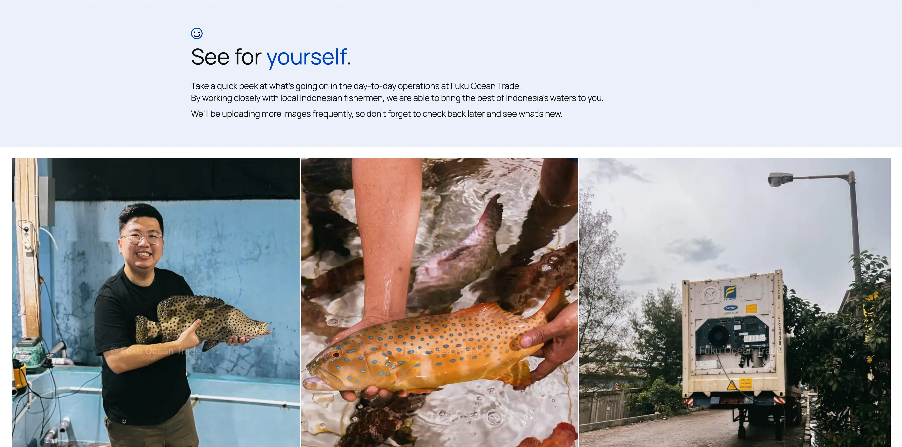
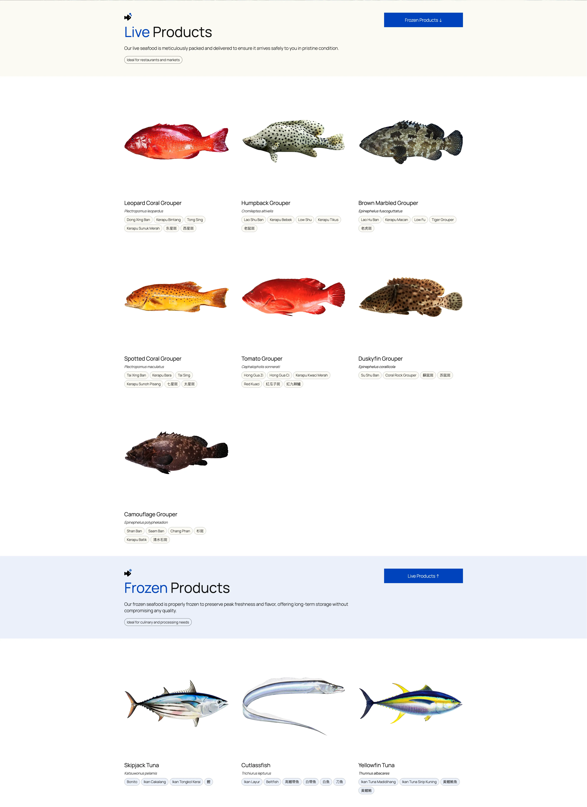
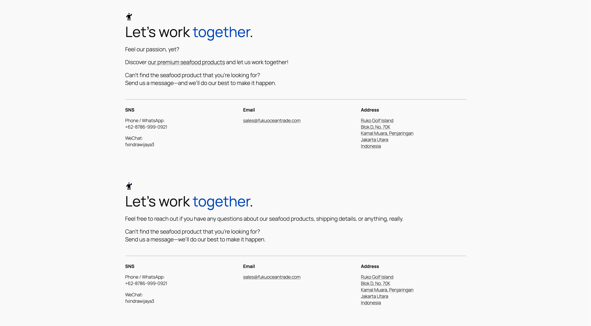

# Brief
Fuku Ocean Trade is a seafood trading company specializing in groupers, founded by Indra, a close friend of mine. It first humbly began as his side hustle in 2022 and has been growing rapidly since.

In early 2025, wanting to reach a wider and more international audience, Indra asked me to help him with 2 things:
- A brand that will be able to convey what the company does and stands for
- A professional-looking website

***

# The Process
## Hard Question, Simple Answer
Design Question:
- How would we earn the trust of international buyers who have never heard of Fuku Ocean Trade, and get them to reach out?

A Surprisingly Simple Answer:
- Keep it genuine - show the real person, the real products, and the real work behind the business

### Identity Design
## A Little Bit of Luck
For the brand, I drew inspiration from the Japanese and Chinese word 福 (fuku / fú), meaning “good fortune,” and paired it with what Fuku Ocean Trade knows best - groupers.

*Inspired by the Japanese and Chinese word 福 (fuku / fú), meaning “good fortune,” and its seafood trading, with a specialty in groupers.*

*250gsm textured name card featuring a striking grouper iconography and the character 福 (fuku) on the front with contact details at the back.*

*Besides helping secure export packaging, custom stickers also make it easier for customers to recognize Fuku Ocean Trade as a brand.*

### Web Design and Development
## Trust in 15 Seconds
With the first half of the project done, I moved on to the website. From the start, I knew that I wanted it to make potential customers feel a sense of trust, so there were three main points that I focused on:
- A genuine face behind the business
- A clear and structured overview of the products
- An easy way to get in touch from any page

With those in mind, I began sketching out the layout (not pictured here, sorry!) and drafting the website content, shaping both around those three points.
  

## Putting a Face to the Name
After some back-and-forth discussion with Indra himself, he agreed with my suggestion to feature his photo and his haul in the homepage hero section.

This is especially important since most users only stay for around 15 seconds, so establishing trust quickly matters - [and using a genuine photo of him “in action” helps achieve that](https://news.cornell.edu/stories/2019/01/seeing-believing-depends-photo-quality-study-says).

*A brief introduction section with Indra's face right under the hero section.*

And to further build on that sense of trust, I also added a “Why Us?” section and a “Behind the Scenes” page.

## Showing the Goods
And of course, the website also needed a catalogue of sorts - a clear and structured way for potential clients to browse and understand what products are available for order. For this part, I:
- Retouched the product images to create a more cohesive look, as the original photos felt a bit too ‘raw’
- Did stylized edits on each fish, using real pictures as the base
- Included the alternative names of each product to add more context to what each product is

*Stylized edits on each fish, alongside their alternative names.*

## Let's Work Together
Lastly, I added a contact section on each page so visitors can easily see how to get in touch with Fuku Ocean Trade while browsing the site.

The copywriting on these is also slightly customized for each page, depending on the context.

*Pictured above are two different “Let's work together” sections on two separate pages.*

### Outcome
This whole project took about a month to complete, and overall I’m quite satisfied with how it turned out - and fortunately, Indra felt the same too.

Since then, Fuku Ocean Trade has grown quite a bit. It now exports seafood to two new countries, Vietnam and Malaysia, where many of its clients first discovered the business through the website. Closer to home, as of November 2026, it also supplies a growing list of restaurants across Jakarta and Tangerang.

Good fortune indeed.